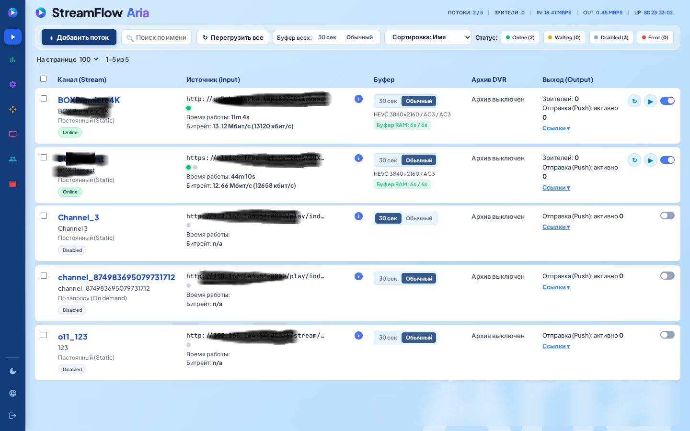
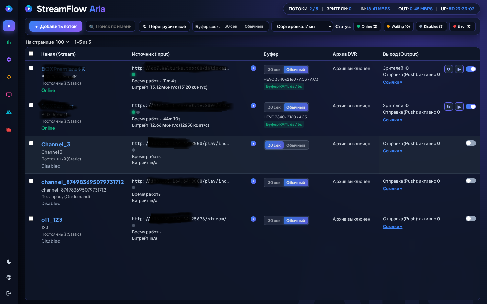

# StreamFlow Aria — IPTV / OTT Media Server

<p align="center">
  <b>Высокопроизводительный сервер потокового вещания IPTV / OTT для Ubuntu 22.04 LTS и Ubuntu 24.04 LTS</b><br/>
  Двойной движок вещания (<b>AstraG Native C-Accelerated Engine</b> + <b>FFmpeg</b>) • Буферизация в RAM (<code>/dev/shm</code>) • Мульти-источники с Failover • Архив DVR • Кластеризация
</p>

---

## Веб-интерфейс (Масштаб браузера 100%)

Интерфейс управления **StreamFlow Aria** адаптирован под стандартный **100% масштаб браузера** (панель фильтрации в одну линию, компактная боковая навигация и наглядная телеметрия потоков) и включает две встроенные темы оформления: **❄️ Glass (Светлая)** и **🌌 Space (Темная)**.

### ❄️ Светлая тема (Glass — Главная страница)



### 🌌 Темная тема (Space — Главная страница)



---

## Основные возможности StreamFlow Aria

### 1. Двойной движок воспроизведения: `AstraG` и `FFmpeg`
В карточке каждого потока на вкладке **Overview (Обзор)** доступен выбор движка обработки (**Playback Engine**):
- **`AstraG`** — интегрированный высокопроизводительный нативный движок приема и мультиплексирования `MPEG-TS / HLS` (на базе [`udemika/astrag`](https://github.com/udemika/astrag)) со встроенным C-ускорителем (`x86_64 ctypes`), парсером таблиц PSI (`PAT`, `PMT`, `SDT`, `NIT`), проверкой счетчиков непрерывности (`Continuity Counter`), расчетом битрейта по меткам `PCR` и кольцевым буфером мгновенного старта (`bootstrap_burst`).
  - **Эксклюзивный режим работы**: при выборе движка `AstraG` поток обслуживается **строго только движком AstraG** (без скрытого переключения на `ffmpeg`).
  - **Мгновенная диагностика ошибок**: если `AstraG` не может принять или декодировать источник, в индикаторе битрейта (`📊`) в окне **Обзор** и в общей таблице каналов отображается статус **`Error`**.
- **`FFmpeg (built-in)`** — универсальный движок с поддержкой любых транспортных протоколов, ремультиплексирования (`-c copy`) и транскодирования видео/аудио.

### 2. Оперативная буферизация в RAM (`/dev/shm/flustream`)
- Все живые сегменты `HLS / LL-HLS` формируются непосредственно в оперативной памяти (`tmpfs` в `/dev/shm/flustream`), что полностью исключает износ SSD/NVMe накопителей.
- Переключение режима буфера в 1 клик (как для отдельного канала, так и глобально для всех потоков):
  - **`30 сек`** — глубокий буфер для защиты от кратковременных обрывов и джиттера на сложных внешних источниках.
  - **`Обычный (6 сек)`** — режим минимальной задержки вещания.

### 3. Резервирование источников (Multi-Input Failover)
- Поддержка протоколов входа: `HTTP / HTTPS (HLS, MPEG-TS)`, `UDP / RTP (Multicast / Unicast)`, `RTSP`, `RTMP`, `SRT`.
- Возможность задать список из нескольких URL-источников (`Input #1`, `Input #2`, `Input #3`...) с автоматическим переключением на резервный источник при падении битрейта или обрыве соединения, а также ручным переключением индикаторами в таблице.
- Два режима работы канала: **Постоянный (`Static`)** — поток активен 24/7, и **По запросу (`On Demand`)** — поток запускается только при подключении первого зрителя и останавливается после таймаута неактивности.

### 4. Мультиформатный выход (Output), Архив DVR и рестриминг (Push)
- **Выходные ссылки для каждого потока**:
  - `HLS`: `http://<SERVER_IP>:8080/<StreamName>/index.m3u8` и `/video.m3u8`
  - `LL-HLS`: `http://<SERVER_IP>:8080/<StreamName>/index.ll.m3u8`
  - `HTTP MPEG-TS`: `http://<SERVER_IP>:8080/<StreamName>/mpegts` (прямая отдача из кольцевого буфера `AstraG` или сегментов RAM)
  - `Web Embed Player`: `http://<SERVER_IP>:8080/<StreamName>/embed.html`
- **Архив DVR (Catchup TV)**: запись эфира на диск с настраиваемой глубиной хранения (в часах) и автоматической очисткой устаревших сегментов.
- **Отправка потоков (Push)**: ретрансляция принятого канала во внешние сети по `UDP`, `RTP`, `RTMP`, `SRT`.

### 5. Кластеризация, Плейлисты M3U и Авторизация зрителей
- **Кластер / Пиры**: объединение нескольких серверов **StreamFlow Aria**, автоматический импорт каналов с вышестоящих узлов с фильтрацией `Only` / `Except`.
- **Генератор и импорт M3U**: массовое добавление сотен каналов из внешних `.m3u / .m3u8` ссылок или текста, а также выгрузка готовых плейлистов (`HLS`, `MPEG-TS`, `DASH`) для IPTV-плееров.
- **Защита потоков (Auth) и Сессии зрителей**: индивидуальные токены доступа (`?token=...`), внешняя авторизация по `on_play` HTTP-хуку, мониторинг всех подключенных клиентов (IP, User-Agent, трафик, время просмотра) с возможностью принудительного отключения (**Kick**).

### 6. Телеметрия Pulse в реальном времени
- Живые графики входящего и исходящего сетевого трафика (`IN / OUT Mbps`), загрузки процессора (`CPU %`), оперативной памяти (`RAM %`), объема RAM-буфера (`SHM MB`) и свободного места на диске архива (`DVR`).

---

## Системные требования

| Компонент | Минимальные требования | Рекомендуемые требования (50+ каналов) |
| :--- | :--- | :--- |
| **Операционная система** | **Ubuntu 22.04 LTS** или **Ubuntu 24.04 LTS** (64-bit `x86_64`) | **Ubuntu 22.04 LTS** / **Ubuntu 24.04 LTS** Server |
| **Процессор (CPU)** | 2 vCPU (`x86_64`) | 4+ ядер CPU (`x86_64` для C-ускорителя AstraG) |
| **Оперативная память (RAM)** | 2 ГБ (минимум 512 МБ под `/dev/shm`) | 8+ ГБ RAM (для буферизации потоков 30 сек в `/dev/shm`) |
| **Дисковое пространство** | 10 ГБ SSD | 100+ ГБ NVMe SSD (при использовании архива DVR) |
| **Права доступа** | `root` или пользователь с `sudo` | `root` |

---

## Установка в Ubuntu 22.04 LTS и Ubuntu 24.04 LTS

Установочный скрипт `install.sh` полностью автономен: он автоматически устанавливает системные зависимости (`python3`, `ffmpeg`, `curl`, `ca-certificates`), разворачивает сервер **StreamFlow Aria** и нативный движок **AstraG** в `/opt/flustream`, создает конфигурацию `/etc/flustream/flustream.conf` и регистрирует системную службу `systemd` (`flustream.service`).

### Способ 1. Быстрая установка в одну команду (Рекомендуется)

Подключитесь к серверу **Ubuntu 22.04** или **Ubuntu 24.04** по SSH и выполните:

```bash
curl -fsSL https://raw.githubusercontent.com/udemika/StreamFlowAria/main/install.sh -o /root/install.sh && chmod +x /root/install.sh && sudo bash /root/install.sh
```

### Способ 2. Пошаговая установка через Git

```bash
# 1. Обновление списков пакетов и установка git/curl
sudo apt-get update && sudo apt-get install -y git curl

# 2. Клонирование репозитория StreamFlowAria
git clone https://github.com/udemika/StreamFlowAria.git
cd StreamFlowAria

# 3. Запуск установщика с правами суперпользователя
chmod +x install.sh
sudo ./install.sh
```

> **Примечание:** При запуске `./install.sh` открывается интерактивное меню установщика, где вы можете выбрать чистую установку сервера, обновление веб-панели и движка без потери текущих потоков, смену порта/пароля администратора или перезапуск службы.

---

## Доступ к веб-панели после установки

После завершения работы скрипта веб-интерфейс **StreamFlow Aria** сразу доступен в браузере:

- **URL панели управления:** `http://<IP-АДРЕС-ВАШЕГО-СЕРВЕРА>:8080`
- **Логин по умолчанию:** `admin`
- **Пароль по умолчанию:** `admin`

*(Изменить порт сервера, логин и пароль администратора можно прямо в веб-интерфейсе в разделе **«Шаблоны и конфиг»** или через меню `install.sh`).*

---

## Управление сервером и структура файлов в Ubuntu 22.04 / 24.04

### Команды службы `systemd`

```bash
# Проверить статус сервера StreamFlow Aria
sudo systemctl status flustream

# Перезапустить сервер
sudo systemctl restart flustream

# Остановить сервер
sudo systemctl stop flustream

# Просмотр логов работы в реальном времени
sudo journalctl -u flustream -f
```

### Расположение файлов на сервере

| Путь | Назначение |
| :--- | :--- |
| `/opt/flustream/server.py` | Основной сервер приложений и веб-панель **StreamFlow Aria** |
| `/opt/flustream/stream_engine.py` | Встроенный движок **AstraG** (`MPEG-TS / HLS` + C-акселератор) |
| `/etc/flustream/flustream.conf` | Главный конфигурационный файл потоков и настроек |
| `/etc/flustream/ui_prefs.json` | Настройки темы (`Glass` / `Space`) и языка интерфейса (`RU` / `EN`) |
| `/dev/shm/flustream/` | Оперативный RAM-буфер активных сегментов (`tmpfs`) |
| `/var/lib/flustream/dvr/` | Дисковое хранилище архива передач (DVR) |
| `/etc/systemd/system/flustream.service` | Unit-файл службы `systemd` (автозапуск при старте Ubuntu) |

### Пример конфигурации потока с движком `AstraG` (`flustream.conf`)

```nginx
http 8080;
edit_auth admin admin;

stream BOXPremiere4K {
  title "BOX Premiere 4K";
  input http://qx7.halturka.top:80/iGliukasV/video.m3u8;
  engine astrag;
  buffer_mode normal;
  source_timeout 30;
  clients_timeout 45;
}
```
